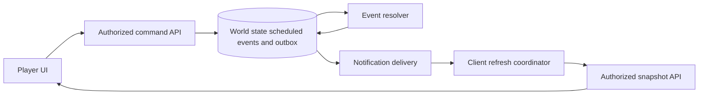

# Worked design: Design a progressing event engine and reconnectable client state

## Start with a bounded user journey

A player issues a command, a server worker resolves due work, and the browser learns the committed result. The player may disconnect, miss notifications, switch accounts/worlds, and later reconcile from an authorized snapshot.

The invariant is: **An eligible world event has one policy-consistent committed effect, and client refresh/reconnect cannot make another world or obsolete account own the current displayed state.**

Non-goals: Do not design a global real-time action game, promise exactly-once message delivery, or replace transactional ownership with deterministic event sorting.

Before choosing infrastructure, write three acceptance examples: an ordinary successful operation, a repeated or conflicting operation, and an unavailable dependency. Define what the user can still do in each case. A phrase such as highly available is incomplete until you name the operation and the behavior allowed when a dependency fails.

## Worked target architecture

This is the teaching design to evaluate, not a deployment inventory. [Source observations](README.md) distinguish what is present from what is proposed.

Separate event selection, ownership, resolution, commit, and notification. Sorting due events decides which work a worker would like to attempt. It does not prevent another worker from selecting the same event. The actual resolver must enforce an eligible transition or equivalent idempotent effect inside the appropriate transaction; inspect that boundary before claiming duplicate-effect safety.

Commit state changes and notification intent together when the architecture requires reliable downstream notification. Delivery can retry and clients can receive duplicate hints. The browser should reconcile against authorized current state after reconnect rather than depending on perfect transport delivery. A missing event in a sequential projection can trigger a snapshot reload; whether the actual API exposes revisions must be checked, not assumed from the teaching model.

Client ownership includes account and world. The inspected refresh coordinator already addresses an older in-flight request followed by a dirty refetch, so explain that behavior before proposing replacement code. Account reset has a separate boundary because previously private query data must not carry into another identity.

Capacity and fairness must be considered per world as well as globally. A per-batch world quota can limit one world's share of a batch without proving it can never starve under repeated scheduling. If measured skew requires stronger fairness, introduce a deliberate scheduling policy with persistent state and a testable progress claim.

## Read the diagram as a set of obligations

For each arrow, state the caller, trust context, timeout or transaction boundary, and observable outcome. Label a database write differently from a notification hint or a local draft update. A line crossing into a worker or provider is a potential failure window; it does not inherit atomicity from an earlier database transaction.

Choose one authoritative record for each decision. Derived caches and UI projections can be rebuilt only if the source of truth and reconstruction policy are clear. A read replica or cached response can be appropriate for some reads while being inappropriate for the admission decision that protects the invariant. Name that distinction before adding either component.

## First implementation slice and later growth

The first proposed slice should support the bounded journey with the existing architecture wherever possible. Include contract validation, authorization, the decisive state transition, a truthful response, and the focused regression that rejects the named failure. If the existing code already meets the behavior, the useful work is characterization and evidence rather than replacement.

Scale in response to a specific bottleneck. More stateless API instances may help request handling while leaving a hot row, connection limit, provider quota, or downstream queue unchanged. A queue can smooth a burst but cannot make sustained arrival exceed processing capacity indefinitely. A cache can reduce eligible reads but adds identity and freshness obligations.

Explain one alternative that could be correct under different requirements. Use the [decision record](05-design-decisions.md) to state the cost of your choice and the observation that would make you reconsider it. The goal is a design another engineer can challenge with a concrete failure, not the largest possible collection of boxes.
